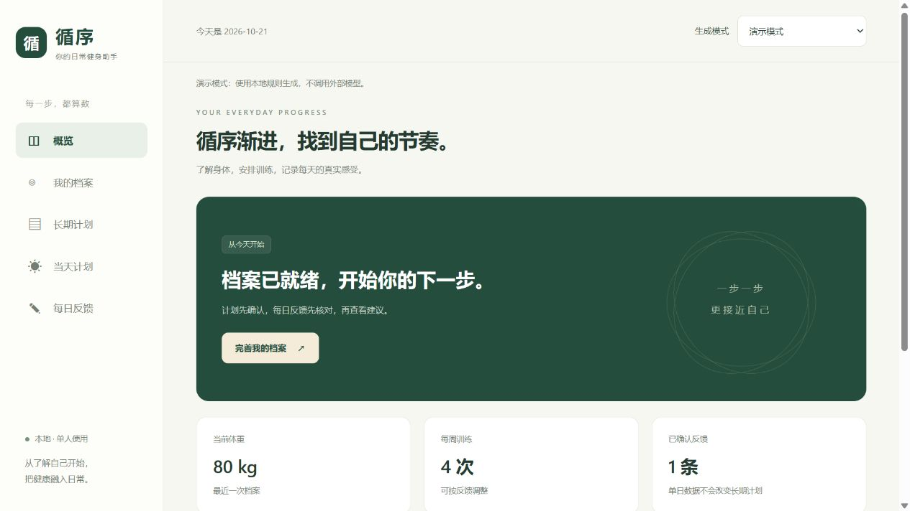
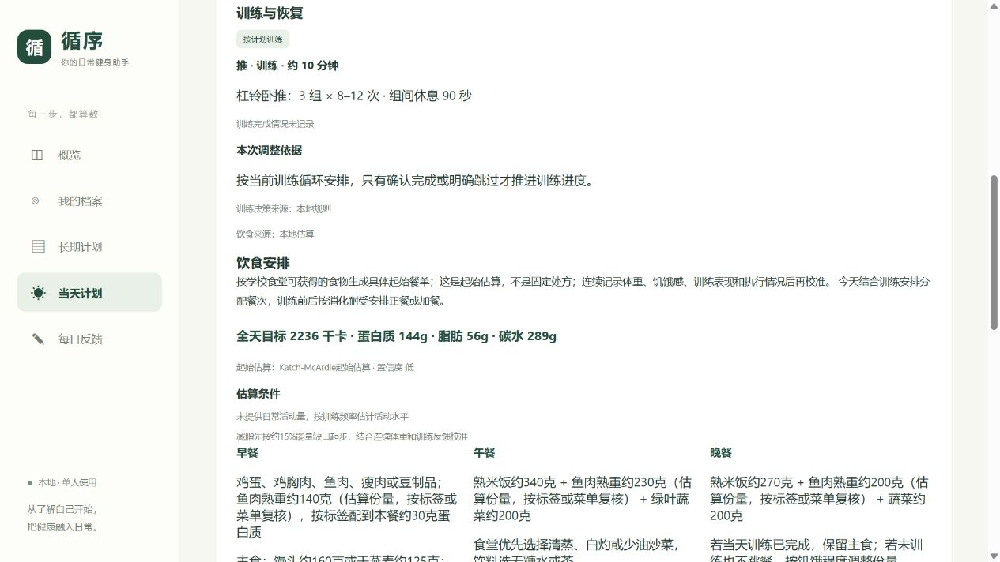
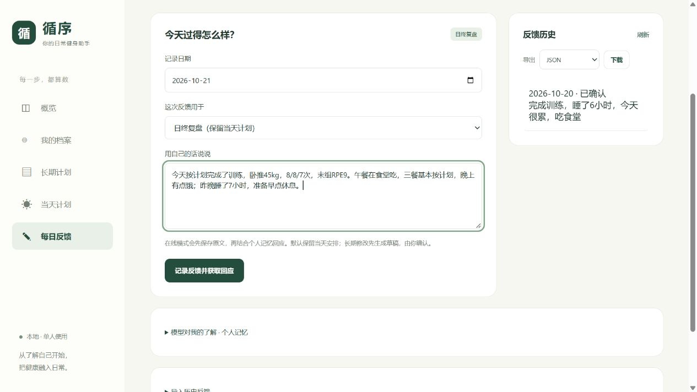

<div align="center">

# 循序

### 每一步，都算数。

一个本地优先的 AI 健身助手，陪你安排训练、吃好三餐、记录真实的每一天。

**长期方向 · 当天安排 · 日常复盘**

[快速开始](#快速开始) · [交给你的 Agent 安装](docs/agent-local-setup.md) · [工程文档](docs/engineering-guide.md)

</div>



## 找到自己的节奏

健身计划需要适合你的生活：今天有多少时间、食堂能吃到什么、上次训练感觉如何，都值得被考虑。

**循序**把长期目标和每天的行动放在一起。先了解你的身体、目标与条件，再安排训练和饮食；训练后或睡前，用自己的话留下反馈，让后续安排有据可依。

## 从计划，到每一天

| | 循序能帮你做什么 |
| --- | --- |
| **了解自己** | 保存目标、训练经验、可用器械、饮食预算与偏好；力量参考可以选填，不确定的内容可以留空。 |
| **确定方向** | 制定并确认长期训练与营养方案，按自己的训练循环推进。 |
| **安排今天** | 在一个页面查看训练、三餐、饮水与恢复安排，结合当天时间、疲劳和饮食条件主动更新。 |
| **记录感受** | 用自然语言复盘训练、饮食和睡眠；在线模式结合历史与个人记忆回应，必要时追问或提出调整。 |
| **留住记录** | 档案与历史保存在本地，支持导出、备份与恢复，方便回顾自己的过程。 |

### 今天练什么，怎么吃

训练与饮食放在同一份当天计划里，从动作组次到餐食份量，都能逐项查看。已经完成的训练与餐次会保留，长期方案的变更需要确认。



### 不必把每天都填成表格

“卧推最后一组有点吃力，午餐在食堂吃，晚上有点饿。”

用自己的话记录就好。在线复盘会参考已有计划与历史，逐步整理对你的了解；需要更正时，也可以直接说明。

同一天的补充反馈会合并用于趋势统计；实际训练可保留每组次数、重量和 RPE，并供下次同动作规划参考。临时状态会到期，长期偏好可以确认或停用；每条记忆都可查看原文依据。训练或饮食是否完成不明确时，会请你确认。具体规则见[历史与记忆说明](docs/history-and-memory.md)。



> 以上为应用实际界面截图，使用合成档案与 demo 数据，不包含真实个人记录；不代表在线模型的生成效果。

## 在自己的电脑上使用

- **先体验，再接模型。** demo 模式无需 API Key，不调用外部模型；启用在线模式后，训练、饮食规划与反馈复盘可使用你配置的模型。
- **数据放在自己手里。** 个人记录保存在本地 SQLite；在线模式会将相关上下文发送到你选择的模型供应商。
- **开箱即有知识参考。** 仓库附带已审核知识卡和来源，供规划与反馈按需参考。

## 快速开始

需要 **Python 3.11+**。普通使用无需 Node.js、前端构建或额外数据库服务。

最省事的方式：把仓库地址与 [本地安装指南](docs/agent-local-setup.md) 交给你的 Agent：

> 请按照这个项目的 `docs/agent-local-setup.md`，在我的电脑上完成安装、demo 启动和验收。保留已有数据，不输出密钥，完成后告诉我访问地址和再次启动的方法。

也可以手动启动：

```bash
git clone https://github.com/1saachen/xunxu.git
cd xunxu
```

**Windows / PowerShell**

```powershell
py -3.11 -m venv .venv
.\.venv\Scripts\python.exe -m pip install -e .
.\.venv\Scripts\python.exe -m uvicorn fitness.main:app --host 127.0.0.1 --port 8000
```

**macOS / Linux**

```bash
python3 -m venv .venv
./.venv/bin/python -m pip install -e .
./.venv/bin/python -m uvicorn fitness.main:app --host 127.0.0.1 --port 8000
```

浏览器打开 **[localhost:8000](http://127.0.0.1:8000/)**，填写并保存自己的档案，从第一份长期计划开始。未配置在线模型时默认使用 demo；在线配置、时区和故障排查见 [安装指南](docs/agent-local-setup.md)。

## 继续了解

- [本地安装与 Agent 部署指南](docs/agent-local-setup.md)：跨平台安装、在线模型配置与启动验收。
- [工程文档](docs/engineering-guide.md)：运行机制、数据管理、知识维护、开发测试与当前限制。
- [API 合约](docs/api-contract.md)：接口与数据结构。
- [数据边界](docs/data-boundaries.md)：备份恢复、隐私与部署边界。

循序目前是持续开发中的单用户本地应用，请绑定 `127.0.0.1` 使用。训练与营养安排用于日常参考，不能替代医疗建议；身体不适时应停止训练并寻求专业帮助。

<div align="center">

**循序 · 为真实的每一天。**

</div>
